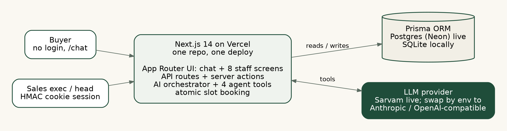
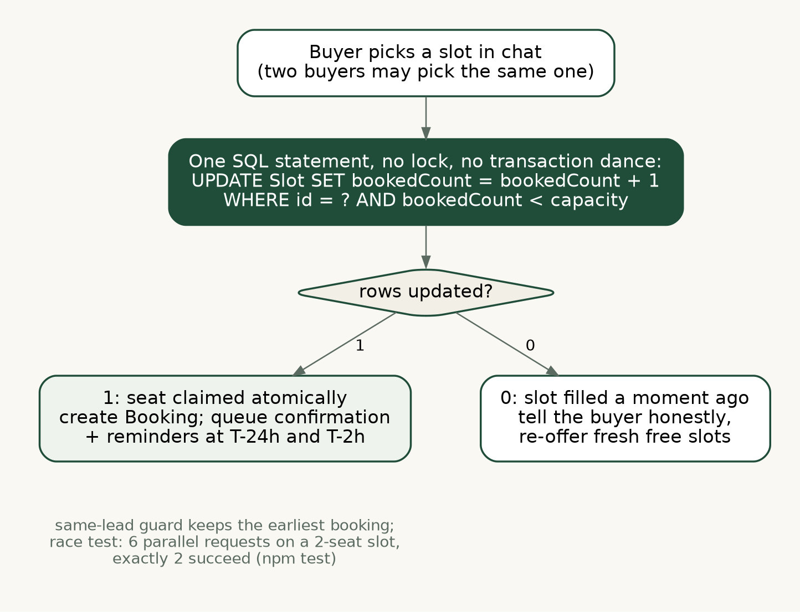
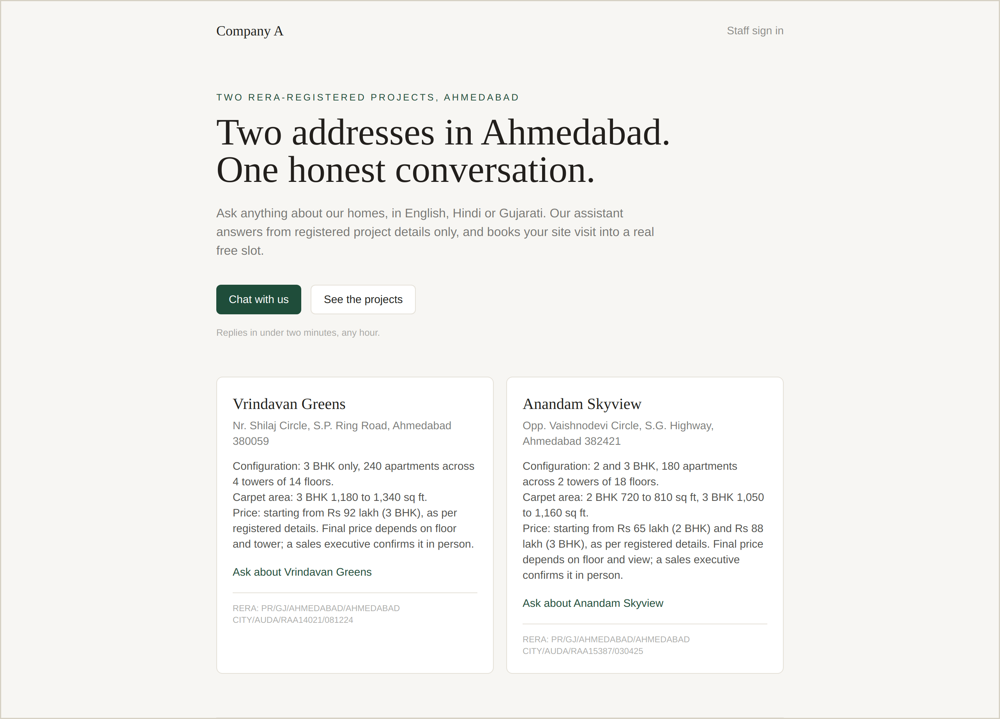
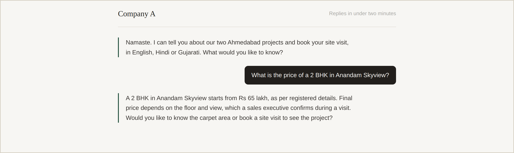
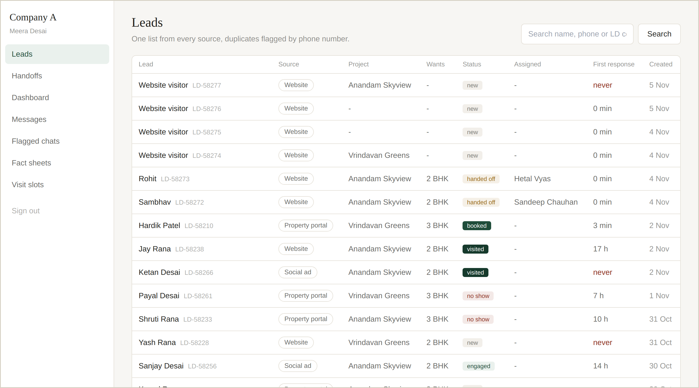
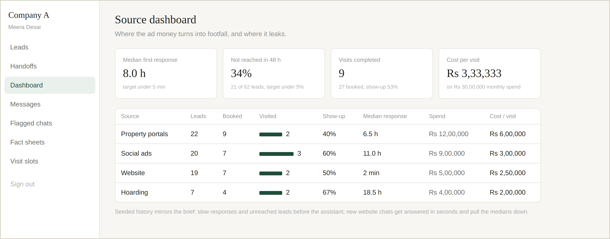

# Technical Design Document
## AI lead-response and site-visit booking assistant for a residential developer

**GitHub:** https://github.com/Punitjain2/lead-assist
**Live app:** https://lead-assist-i48z.vercel.app
**Demo logins:** see deployment.md

---

## 1. What this is

The client pays about Rs 1,000 per lead and loses 35% of them to slow human response.
This build answers every web enquiry in seconds, in English, Hindi or Gujarati, answers
only from the sales head's fact sheet, collects budget and needs, books a site visit
into a genuinely free slot, and hands serious buyers to a named executive with a
summary. A dashboard shows response time, visits, show-up rate and cost per visit by
source. All core-build screens work end to end on seeded data; the optional must-haves
(fact-sheet editor, slot manager, reminders queue, duplicate detection, opt-out) are
built as well.

## 2. Architecture and why

Next.js 14 (App Router, TypeScript) serving both the UI and the API, Prisma over SQLite
locally and Postgres in production, and an LLM with tool use for the
agent (Anthropic or any OpenAI-compatible provider; the live deployment runs Sarvam). One repo, one deploy, no separate backend service.



*Figure 1. One Next.js deployment; the AI provider and the database are both swappable by environment variables.*

Why this shape: the product is small and chat-centred, so a monolith with server
components removes a whole class of API plumbing; Prisma gives a typed data layer and a
one-command seed; and SQLite-for-review means a reviewer runs the whole thing in four
commands with no database account. The booking concurrency logic was deliberately
written as plain SQL that behaves identically on SQLite and Postgres, so the engine swap
is a config change, not a code change.

Auth is a signed HttpOnly cookie (HMAC, 7-day expiry) with two roles, SALES_EXEC and
SALES_HEAD. Buyers do not sign in: forcing account creation before chat would defeat
the two-minute-response premise. Their identity (name, phone, consent) is collected
conversationally and validated server-side. This is a deliberate product decision,
recorded as an assumption below.

## 3. Data model

User, Lead, Conversation, Message, Slot, Booking, Handoff, FactSheet, Outbox,
SourceSpend.

Key choices:

- **Lead.phone is normalised to +91XXXXXXXXXX** on save. Duplicate detection is a
  lookup on that canonical form: a second enquiry from the same number is created,
  linked via `duplicateOfId`, and badged in the lead list with a note naming the
  original lead and source. Merging is left to a human; auto-merge deletes information.
- **Slot carries `capacity` and `bookedCount`** with a unique (project, startsAt).
  Booking carries a unique (leadId, slotId).
- **Outbox is the messaging mock.** Booking creates three rows: confirmation now,
  reminders at T-24h and T-2h, each with the location pin and RERA number in the body.
  A screen shows the queue and a button plays the role of the production cron.
  Opted-out leads are excluded at send time and their queued rows are deleted on opt-out.
- **FactSheet is data, not prompt text.** The sales head edits it in the admin screen;
  the agent's system prompt is rebuilt from the database on every call, so an edit
  changes the very next answer.

## 4. The booking hard part: no double booking



*Figure 2. The whole concurrency story is one conditional UPDATE; both branches are honest to the buyer.*

The capacity check and the seat claim are a single atomic statement:

```sql
UPDATE "Slot" SET "bookedCount" = "bookedCount" + 1
WHERE "id" = ? AND "bookedCount" < "capacity"
```

If zero rows update, the slot is full and the caller is told to offer another time. No
transaction is held open across reads, which also avoids SQLite's single-writer
timeouts under load. Two follow-up guards use compensating decrements: the unique
(leadId, slotId) constraint returns the seat if the same pair races itself, and a
same-lead guard keeps only the earliest active booking (deterministic tie-break on id)
if one buyer double-submits across two slots.

Tested in `tests/booking.test.ts`: six simultaneous requests against a 2-seat slot
produce exactly 2 bookings and 4 SLOT_FULL results, with `bookedCount` equal to 2 and
no leaked seats; plus tests for second-booking refusal, consent refusal, and opt-out
refusal. All pass.

The AI never decides availability. Its booking tool calls this same server function,
and when the server says SLOT_FULL the agent apologises and offers the next options.

## 5. How the AI part works, including when it is wrong

The agent is provider-agnostic by design. The four tools, their executor and the
system prompt live in one shared module (`lib/agentTools.ts`); two thin drivers speak
the provider protocols: Anthropic messages+tools, and the OpenAI chat-completions
tool-calls format, which covers Sarvam, Mistral, Groq, Gemini and OpenAI through three
env vars (`AI_BASE_URL`, `AI_API_KEY`, `AI_MODEL`). Sarvam (`sarvam-105b`) is the
deliberate budget alternative here: it is OpenAI-compatible with tool calling and is
trained for 22 Indian languages plus English, which fits a Gujarati- and Hindi-speaking
Ahmedabad buyer base. Because both drivers call the same executor, the booking
atomicity, consent rules and handoff behaviour cannot drift between providers.
Reasoning-heavy models can spend the whole token budget thinking and return an empty
answer; the compatible driver strips think-tags, retries once forcing a plain text
answer, and only then falls back to a handoff.

The agent runs four tools in a server-side loop (max 6 turns):

- `save_lead_details`: name, phone (validated as an Indian mobile, else the tool tells
  the model to re-ask), project, 2/3 BHK, budget band, language, and an explicit DPDP
  consent boolean. Saving a phone also runs the duplicate check.
- `get_free_slots`: real availability from the database, next 10 days.
- `book_visit`: the atomic server booking above; requires name, valid phone and consent
  already saved, otherwise it returns an instruction to collect them first.
- `handoff_to_human`: round-robin to the executive with the fewest open handoffs,
  writes a 3-4 line summary, flags the conversation for the sales head's daily review.

Failure handling, in order of the brief's rules:

1. **Facts only from the fact sheet.** The system prompt injects both sheets from the
   database and forbids anything beyond them. A missing fact produces "a team member
   will confirm" plus a `fact_missing` handoff.
2. **Never a final price or discount.** Starting prices printed in the sheet may be
   read out "as per registered details"; any negotiation triggers a
   `price_negotiation` handoff. The seeded Hindi conversation on lead LD-58211 shows
   this path verbatim.
3. **A person on demand.** "I want to talk to someone" hands off immediately.
4. **API down or key missing.** The chat does not error out: the buyer is told a named
   person will reach out, a handoff is created with the reason, and the conversation is
   flagged. This path is live in the demo whenever the key is absent.
5. **Input limits.** Messages capped at 1,000 characters, conversations at 80 messages
   (then routed to a human), request bodies validated with zod.

Demo mode, declared openly: with `MOCK_AI="1"` and no API key, a scripted keyword
assistant (`lib/mockAgent.ts`) replaces the model so the whole flow can be reviewed
keyless. It is not the AI and the chat labels it "Demo mode" on screen; its value is
that it exercises the identical server tools (same `bookVisit`, same `freeSlots`, same
`createHandoff`, same consent and validation rules), so the booking and guardrail
plumbing being reviewed is the production plumbing either way.

Language: the prompt instructs the model to reply in the buyer's language and switch
when the buyer switches; English, Hindi and Gujarati chips sit above the composer.

First response time is recorded the moment the assistant's first reply lands, which is
what the dashboard's median measures.

## 6. UI and design decisions

The brief says design counts as much as features and the homes cost up to Rs 1.2 crore,
so the direction is quiet and editorial rather than app-like: a warm paper background
(#F7F6F3), near-black ink, a single deep pine green (#1F4D3A), one serif display face
for headings and the system sans for everything else. No gradients, no decoration
without a job.



*Figure 3. Landing: both projects with RERA numbers and the DPDP consent line before any chat starts.*



*Figure 4. Live chat on the deployed app: the price answer quotes the fact sheet and defers the final price to a sales executive.*

- **Chat** is the one bold element. Assistant replies are typeset as text with a thin
  pine rule rather than bubbles, which reads calm and premium on a phone; the buyer's
  words sit in solid ink blocks. The RERA numbers, the registered-details disclaimer
  and the DPDP consent line live permanently in the footer, because compliance text
  that only appears sometimes is compliance text that gets missed.
- **Lead list** answers the telecaller's first question (who is new, from where, has
  anyone replied) in one row each: source chip, status chip, first-response time with
  "never" in red, amber duplicate badge with the original lead on hover.



*Figure 5. Lead list as the sales head sees it: every source in one place, status chips, first-response time, red "never".*
- **Flagged chats** gives the sales head the brief's daily review in one screen:
  every conversation the assistant flagged, with the reason (discount asked, fact
  missing, person requested) and the last exchange, newest first.
- **Dashboard** leads with the four numbers the Director is buying: median first
  response, percent unreached in 48 hours, visits with show-up rate, cost per visit.
  The per-source table uses small inline bars instead of a chart library.



*Figure 6. Source dashboard: the four numbers the Director is buying, then cost per visit by source.*
- Every screen has loading (server-rendered), empty ("No handoffs yet. They appear
  when...") and error states; the chat has retry-with-your-text-preserved.
- Mobile first: the chat is a full-height single column; the staff sidebar collapses to
  a horizontal scroll nav.

## 7. Security

Secrets only in environment variables, with `.env` git-ignored and `.env.example`
committed. Passwords bcrypt-hashed. Session cookie HttpOnly, SameSite=Lax, HMAC-signed
with constant-time comparison. Middleware plus per-page role checks (admin screens
redirect non-heads); every server action re-checks the session. All API inputs
validated with zod; phone numbers re-validated server-side regardless of what the model
passes. Phone numbers are masked in the Messages screen. Seed data is invented; no real
personal data anywhere.

## 8. Assumptions (labelled, per the rules)

1. Project names, RERA numbers (Gujarat RERA format), addresses, map pins and the
   Rs 30 lakh spend split across sources are invented sample data.
2. Buyers chat without an account; identity is collected in-chat with consent.
   "Sign-in" in the task is satisfied by the roles that need it.
3. Portal and social leads arrive by import in reality; here they are seeded. The
   website source is the one fully live end to end.
4. Show-up is marked manually by the executive on the lead page (Visited / No-show);
   nobody at the gate will integrate hardware in 6 weeks.
5. Cost per visit = monthly source spend / visits completed from that source.
6. Reminder sending is a mocked queue with a manual trigger standing in for a cron.
7. Slot capacity 3 means three families per time slot, matching how site offices
   actually run group walk-ins.
8. Seeded history deliberately mirrors the brief's pain (slow responses, ~35%
   unreached) so the dashboard tells the before/after story.

## 9. What was cut, and what comes next

Cut, knowingly: real WhatsApp (needs Meta business verification and template approval;
the outbox is channel-shaped so it slots in), OTP verification of buyer phones, CSV
import for portal leads, auto-merge of duplicates, payments and allotment (out of
scope by the brief), streaming chat tokens.

Next, in order: WhatsApp Business API with opt-in templates; a cron for the outbox;
phone OTP before booking to kill junk visits; portal lead import with the same
dedupe; show-up capture via a one-tap link sent to the executive at visit time;
weekly flagged-chat digest to the sales head.

## 10. Honest limits

The agent is as good as the fact sheet; a thin sheet means frequent handoffs, which is
the intended failure mode but still a staffing cost. Language quality in Gujarati
should be reviewed by a native speaker before launch. The same-lead double-submit
guard can, in a rare tie, cancel both attempts and ask the buyer to rebook; safe, but
worth a friendlier retry later. SQLite is for review only; the hosted app must run
Postgres. The MOCK_AI demo assistant is English-only and keyword-driven; judge
conversation quality only with a real key.
